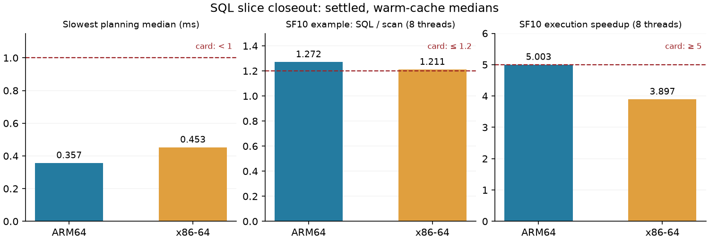

# Slice 4 closeout: SQL planning, execution and engineering checks

Recorded 2026-11-07 (runs started 2026-11-06 UTC). Card:
`docs/slices/0002-select-where-limit.md`. Query implementation is unchanged from
`03daedb`; first-run tooling is `0017bfa`, successful SQL retry tooling `61ba59f`,
and engineering retry tooling `456f2bf` (with the test-only oracle retirement in
the uploaded working tree). The closing change removes the retired parser experiment and updates documentation;
it does not change the measured query execution code.

## Targets against the fixed card

| Target quoted from the card | ARM64 | x86-64 |
|---|---|---|
| Correctness: “Same rows as DuckDB for every query” | MET in native builds: 293/293 differential queries | MET in native builds: 293/293; Miri nearest-double portability NOT MET (R17) |
| Planning: “under 1 ms each (median)” | MET: 289/289; worst 0.357 ms | MET: 289/289; worst 0.453 ms |
| Example: “within 1.2x of nata scan” | SF1 MET (1.128/1.053x); SF10 NOT MET (1.361/1.272x), 1/8 threads | SF1 MET (1.129/1.047x); SF10 NOT MET (1.297/1.211x) |
| R2: “skip at least 60%” | MET: 41/49 = 83.67% | MET: 41/49 = 83.67% |
| Scalability: “5x at 8 threads on SF10” | MET by median: 5.003x, marginal | NOT MET: 3.897x |
| Reliability: “No hang, leak or panic on cancel” | MET: 3,000 fault/delay + 2,000 process cases under contention, zero failures | MET: same counts, zero failures |
| Fault tolerance: “10,000 cases: no panic, every error has a position” and failures from below | MET in ordinary build: mutation/position, damaged-file and injected-fault suites | MET in ordinary build: same suites |
| Resource limits: “1 MB”, “1,000”, “10,000 small files” | MET in ordinary build; default nofile 1024, 10,000-file RSS 11,080 KiB | MET in ordinary build; default nofile 1024, 10,000-file RSS 12,404 KiB |
| SF10 resources: “within the scan's memory and open-file bounds” | MET: 67,352 KiB, eight handles, one footer | NOT MET RSS: 114,964 > even 99,269 KiB conservative task-proxy bound; handles/footers and accounted bytes MET |
| Portability: “ARM64 and x86-64, clean VMs” | MET for normal suites and benchmarks | MET for normal suites and benchmarks; engineering instrumentation below is x86-only |
| Compatibility: documented subset and unsupported list tested | MET: dialect, rejection and differential suites | MET: same suites |
| Security/privacy: untrusted text cannot overflow/panic; no identifiers or secrets | Normal bounds/fuzz and leak scans MET; instrumented build unmeasured | Normal bounds/fuzz and leak scans MET; ASan depth safety NOT MET (R15) |
| Operability: golden EXPLAIN/ANALYZE and seeded replay | MET: golden/CLI/seeded suites | MET: same suites |
| Regression harness: tolerance larger than twin spread, known slowdown rejected | MET: 20% > 5.104%, real PASS / planted FAIL | MET: 20% > 3.734%, real PASS / planted FAIL |

ASan, TSan, Miri, dependencies and source inventory have their own statuses below.
A closed card here records the misses as deviations; it does not assert all targets passed.



## Method and limits

Clean Spot VMs in us-central1-a: n4a-highcpu-8 (ARM64) and c3d-highcpu-8
(x86-64, AMD EPYC 9B14), eight vCPUs and 16 GiB each; ARM64 is Neoverse-N3. Debian 12, Rust 1.99.1 release builds; nightly-2026-08-21 for instrumentation.
SF1 and SF10 TPC-H Parquet; warm OS cache.
Five rounds alternate Nata, competitor and identical control. Each timed block
waits for one-minute load below 0.5; the raw settle records determine whether a
number qualifies under ADR 0006 rule 7. No local smoke timing is evidence here.

Planning covers all 251 SQL and 37 documented-difference queries plus the card
example, including rejection paths, without silently dropping queries. Each
sample is the median of 20 in-process calls. Nata includes the parser thread,
parse, bind and filesystem schema lookup, excluding destruction of the returned
plan. DuckDB 2.0.0 uses in-process EXPLAIN through its Python binding, including
plan rendering and transfer to Python. These are planning-path measurements,
not isolated parser costs. Each query's median is checked against 1 ms.

The example arms use the same physical columns, exact pushed predicates, LIMIT
10 and CSV output. SQL additionally computes the net-price expression. DuckDB's
rows are checked first. Every process time includes startup, metadata and output;
separate Nata version / DuckDB empty-query probes state the startup floor and
are not subtracted. The scan twin controls drift. SF10 execution scaling uses
EXPLAIN ANALYZE of a full single-column scan (all rows evaluated, no per-row CSV),
and also times the fully rendered SQL to isolate output serialization. The scan
benchmark's count mode likewise excludes per-row formatting.

Resource probes execute SQL over 10,000 hard-linked one-row files and full SF10,
then the same scan projection, without raising the fresh VM's descriptor limit.
Reports retain RSS, worker handles, pending footers, largest task and peak
inflight bytes. Single resource samples establish bounds, not timing claims.

## Draft review and local validation

Kept the draft job registration, in-process timer, alternating benchmark outline,
and CSV regression comparator. Fixed silent planning-corpus exclusions, missing
SQL fixtures, the scan's missing LIMIT, the latency-only scaling probe, absent
startup/resource controls, scenario counts and missing process contention run.
Added scan benchmark reproduction, differential checks, registration tests,
Miri coverage for SQL and execution, and leak checks of exported source using an
external temporary Git index (the VM tarball contains no `.git`). Scratch lives
on disk. Backup patch and archive outside the repository were left intact.

Local checks use `TMPDIR=$HOME/tmp-close`, with `AI_AGENT` absent: formatting,
workspace Clippy with warnings denied, workspace tests, job-chain and orchestrator
stub tests, regression invalid/missing/slowdown tests, and closing differential
sets (5/5 scan, 251/251 SQL, 37/37 differences). The smoke test exercised the full
benchmark with SF1 in both slots and a synthetic settle input; its numbers are
not used for thresholds.

## Failures corrected in the open

The first `slice4close` runs passed the functional and contention checks but
failed in the benchmark's added 10,000-file scan control: the driver passed a
literal glob, while `nata scan` accepts an explicit file list. The SQL glob
itself passed. The driver now expands the file list, resets its owned fixtures
on step restart, and writes each timing to CSV immediately. First-run timings
were not retained in CSV and are not used as evidence. Both failed VMs and disks
were cleaned before their one permitted retry.

The first engineering run stopped ASan and TSan at the scan RSS-budget assertion.
ASan measured 488,196 KiB against a normal-allocator bound of 130,501 KiB; no
sanitizer memory-error diagnostic preceded it. A diagnostic probe reduced ASan's
quarantine (8 MiB global, 64 KiB thread-local) and RSS fell to 137,640 KiB, still
over its 132,321 KiB normal-allocator bound. Accounted inflight bytes remained
within window × largest task. This isolates much of the extra RSS to sanitizer
quarantine; shadow metadata and allocator redzones remain additional overhead.

The retry keeps default sanitizer detection settings. It excludes exactly the
two RSS-budget tests from ASan/TSan and runs both uninstrumented in a separate
engineering step, as well as on both SQL VMs. All other CLI/resource tests still
run instrumented. This is a coverage deviation, not a relaxed memory threshold.
Miri checks the existing pruning/kernel tests, 64 seeded SQL pushdown cases and
executor scalar unit tests; process, signals and file-decoding tests belong to
sanitizers. The regular SQL property suite still runs all 4,000 cases on both
architectures. The engineering summary now fails after collecting a nonzero or
empty sub-check status; a planted failure verifies propagation.

The engineering run was explicitly stopped after those failures to avoid
repeating work. Its orchestrator reports zero VM seconds and $0.000 on TERM,
which is an accounting defect, not free compute (register R14). The VM creation
and cleanup logs show roughly 14 minutes: about $0.016 compute at $0.0687/hour,
plus IP/disks. Both the incorrect report and this correction are retained.

The engineering retry subsequently found **ASan NOT MET**: a maximum-depth test
in `nata-exec/tests/deep.rs` aborts with a stack-overflow report. `addr2line`
resolves its repeating frames to `sqlparser` 0.63.0's `parse_prefix`,
`parse_subexpr`, `parse_expr` and `parse_expr_prefix_by_reserved_word` (raw
`eng-address-symbols.txt`). The ordinary clean-VM depth tests pass on both CPUs;
the instrumented parser's fixed stack is insufficient on this path. Register
R15 tracks the stack-budget diagnosis/fix without reducing the documented limit.

Cargo originally stopped at the first failing test binary. On the same retry VM,
remaining ASan test binaries were explicitly attempted with `--no-fail-fast`,
recorded separately; this does not turn the depth failure green. Future runner
invocations now use `--no-fail-fast` to preserve coverage after a failed binary.
There was no third engineering VM/run.


## Measured planning and latency

| CPU | complete planning queries | slowest query median (ms) | corpus median (ms) | DuckDB corpus median (ms) | under 1 ms each |
|---|---:|---:|---:|---:|---|
| arm64 | 289 | 0.357247 | 0.080858 | 0.759685 | MET |
| x86 | 289 | 0.453160 | 0.162885 | 0.640220 | MET |

Card: “Parsing and binding of the test-set queries under 1 ms each (median)”. Raw summaries retain every query, minimum, median and maximum.

Card: “end-to-end time of the example query within 1.2x of `nata scan` with the same columns and pushed filter”.

| CPU | data / threads | SQL ms [min, max] | scan ms [min, max] | DuckDB process ms | SQL / scan | twin / scan | verdict |
|---|---|---:|---:|---:|---:|---:|---|
| arm64 | sf1 / 1 | 9.149 [8.887, 9.429] | 8.112 [8.058, 8.186] | 40.332 | 1.1278 | 0.9976 | MET |
| arm64 | sf1 / 8 | 14.010 [13.184, 15.161] | 13.302 [12.508, 13.820] | 48.925 | 1.0532 | 0.9956 | MET |
| arm64 | sf10 / 1 | 14.926 [14.482, 15.209] | 10.965 [10.640, 11.368] | 51.301 | 1.3611 | 0.9923 | NOT MET |
| arm64 | sf10 / 8 | 18.897 [15.487, 19.195] | 14.859 [14.464, 15.228] | 59.707 | 1.2717 | 1.0060 | NOT MET |
| x86 | sf1 / 1 | 12.503 [11.666, 12.739] | 11.070 [10.764, 11.461] | 50.345 | 1.1295 | 1.0050 | MET |
| x86 | sf1 / 8 | 20.888 [20.359, 21.598] | 19.956 [19.226, 20.209] | 66.032 | 1.0467 | 1.0373 | MET |
| x86 | sf10 / 1 | 20.068 [19.844, 20.769] | 15.468 [14.868, 15.897] | 66.303 | 1.2974 | 0.9953 | NOT MET |
| x86 | sf10 / 8 | 27.371 [26.949, 29.489] | 22.595 [22.085, 24.018] | 81.588 | 1.2114 | 1.0014 | NOT MET |

| CPU | Nata startup-floor median ms [min, max] | DuckDB empty-query median ms [min, max] |
|---|---:|---:|
| arm64 | 1.371 [1.330, 1.574] | 33.878 [33.206, 40.906] |
| x86 | 1.991 [1.785, 2.162] | 42.124 [41.214, 43.184] |

## SF10 scaling

Card: “5x at 8 threads on SF10”. Execution uses EXPLAIN ANALYZE to exclude per-row formatting, as scan count mode does. Full CSV rendering is a separate control.

| CPU | 1 thread s [min, max] | 8 threads s [min, max] | speedup | twin 1 / 8 ratios | rendered 1 / 8 s | rendered speedup | verdict |
|---|---:|---:|---:|---|---|---:|---|
| arm64 | 0.343460 [0.340432, 0.348589] | 0.068654 [0.067877, 0.068845] | 5.0028x | 1.0009 / 0.9601 | 2.234175 / 2.211430 | 1.0103x | MET |
| x86 | 0.375029 [0.367706, 0.381195] | 0.096227 [0.085060, 0.098928] | 3.8973x | 1.0080 / 0.9833 | 2.650252 / 2.703043 | 0.9805x | NOT MET |

ARM64 is marginal: its median barely clears five, and the min/max envelope crosses five. This is weak positive evidence, not a robust fivefold guarantee. Rendering serializes output; the rendered/control comparison isolates that cost.

## Resource bounds and pruning

Card: “A query over 10,000 small files and over SF10 stays within the scan's memory and open-file bounds”, on a clean VM with its default limits.

| CPU | probe | SQL / scan peak RSS KiB | SQL open files / footers | SQL inflight / window × largest task B | verdict |
|---|---|---|---|---|---|
| arm64 | files10000 | 11080 / 10160 | 8 / 13 | 1,872 / 3,328 | MET |
| arm64 | resource-sf10 | 67352 / 56960 | 8 / 1 | 16,014,208 / 17,851,904 | MET |
| x86 | files10000 | 12404 / 8732 | 8 / 12 | 1,768 / 3,328 | MET |
| x86 | resource-sf10 | 114964 / 71652 | 8 / 1 | 16,014,208 / 17,851,904 | NOT MET |

arm64: default RLIMIT_NOFILE=(1024, 1048576). Sorted SF1: 41/49 row groups skipped (83.67%), target “at least 60%”: MET.


x86: default RLIMIT_NOFILE=(1024, 1048576). Sorted SF1: 41/49 row groups skipped (83.67%), target “at least 60%”: MET.


The RSS comparison is conservative: 32 MiB fixed allowance alone covers the one-row-file probe; ARM64 SF10 is below 77 MiB = 32 MiB + 3 × 16 × 122,880 × 8 bytes even without a baseline. On x86-64, a LIMIT-0 probe after the scan benchmark measured SQL baseline 14,200 KiB (scan 10,328 KiB); the value-byte budget is 93,048 KiB. Even using the larger reported task size (1,115,744 B) as M instead of decoded value bytes gives 99,268.5 KiB, still below 114,964 KiB. The 122,880-row i64 group is 983,040 decoded value bytes; Arrow headers do not close a 21,916 KiB gap. The normal generated wide-row resource tests independently check the full baseline + 3 × window × decoded-largest-group + 32 MiB formula, and show an unbounded window breaks it, on both CPUs. The SF10 probe returns all 59,986,052 rows; the 10,000-file probe returns 10,000 rows.


## Regression gate

`regress.sh` uses a 20% tolerance. The gate is deliberately not in CI: shared runners are noisy. SQL baselines use rounds 0/2/4 and held-out samples use rounds 1/3 from the same settled alternating session; they are disjoint samples, not an independent later cloud run. Scan baselines use current primary arms; the held-out comparison uses their five interleaved identical twins. An extra comparison with the older scan record flagged a regression and is retained separately; it is not a controlled attribution to code. Future comparisons reduce all five rounds with `regression-summary.py`. Per-query 1 ms verdicts remain separate from the aggregate planning regression metric.

arm64: maximum absolute median twin spread 5.104% < 20%. Real baseline exit 0 (PASS requires 0); planted baseline times multiplied by 0.70 (30% lower), exit 1 (FAIL requires nonzero). The planting makes otherwise equal timings 1.4286x the baseline. Full per-metric output is in the raw directory.

x86: maximum absolute median twin spread 3.734% < 20%. Real baseline exit 0 (PASS requires 0); planted baseline times multiplied by 0.70 (30% lower), exit 1 (FAIL requires nonzero). The planting makes otherwise equal timings 1.4286x the baseline. Full per-metric output is in the raw directory.

| regression metric | ARM64 baseline s | x86-64 baseline s |
|---|---:|---:|
| scan/sf1/threads1 | 0.171000000 | 0.243000000 |
| scan/sf1/threads8 | 0.047000000 | 0.080000000 |
| scan/sf10/threads1 | 1.272000000 | 2.222000000 |
| scan/sf10/threads8 | 0.222000000 | 0.480000000 |
| sql/planning-corpus | 0.000081463 | 0.000163020 |
| sql/scale-sf10/threads1 | 0.342722736 | 0.378277734 |
| sql/scale-sf10/threads8 | 0.068653863 | 0.096226971 |
| sql/sf1/threads1 | 0.009148959 | 0.011953317 |
| sql/sf1/threads8 | 0.013882918 | 0.020537115 |
| sql/sf10/threads1 | 0.014777506 | 0.020068055 |
| sql/sf10/threads8 | 0.018378832 | 0.027158054 |

## Interpretation of the misses

**Example latency: NOT MET at SF10 on both CPUs.** SF1 clears the fixed 1.2x
budget on both. SF10 ratios are 1.3611/1.2717 ARM64 and 1.2974/1.2114 x86-64
(1/8 threads). A source-level cause candidate is the duplicate footer load:
`FsSource::leaves` calls `read_leaves`, which loads full `ArrowReaderMetadata`;
the executor's scan then loads the footer again. SF10 has 488 groups versus
49 at SF1. This attribution is **reasoned, not profiled or isolated by a cached-
footer variant**; it does not explain every microsecond. P12 records the metadata
handoff work. The threshold and raw verdicts are unchanged. The x86-64 eight-thread median is only 0.95% beyond the 1.2x boundary and its envelope crosses it: that NOT MET verdict is not a claim of statistical significance. The one-thread SF10 min/max ratio envelope exceeds 1.2x on both CPUs.

**Scalability: NOT MET on x86-64.** 3.8973x is below five; ARM64's 5.0028x is
MET by median but marginal, with spread across the threshold. Rendering all
60 million rows reduces scaling to about one on both: the execution versus
rendered control isolates a serial output cost. A hardware limit also differs: N4A has one vCPU per physical core, whereas C3D's
default is two hardware threads per core (eight vCPUs are four physical cores).
The runs used default topology. See [Google's CPU platform specification](https://docs.cloud.google.com/compute/docs/cpu-platforms)
and [machine-family specification](https://docs.cloud.google.com/compute/docs/general-purpose-machines).
This is a reasoned contributor to the 3.9x result, not an isolated attribution;
SMT can still provide gains beyond four. The remaining execution cost is not
profiled, and a plain column projection uses its fast path, so scalar kernel
vectorization alone is not established as its cause. P11 stays open.

**SF10 RSS: NOT MET on x86-64.** SQL 114,964 KiB exceeds its measured baseline
14,200 + 3 × 16 × 983,040 / 1024 + 32,768 = 93,048 KiB value-byte budget. Including the larger entire-task proxy as M raises that diagnostic allowance to 99,268.5 KiB and still fails; the conclusion does not depend on omitting small Arrow headers. The scan uses
71,652 KiB; both report exactly 16,014,208 inflight bytes and 1,115,744 largest-
task bytes. That accounting therefore misses the 43,312 KiB SQL-versus-scan RSS
gap. Additional SQL temporaries or allocator retention are reasoned candidates,
not an isolated cause. R16 tracks profiling and a fix within the original bound;
K and the fixed allowance are not raised. ARM64 and both 10,000-file probes pass.

**Historical scan flag retained.** An extra comparison to the earlier committed
scan record rejects ARM64 SF1/one thread: 0.171 / 0.139 = 1.230x, beyond the
20% gate. Both read 53,292,721 bytes. Current twin median 0.166 s is near the old
baseline's 20% boundary, so attribution to a code regression is not established
by this cross-session comparison. `regression-historical.txt`, `regression-historical-baseline.csv` and
`regression-historical-new.csv` retain an exactly reproduced failure; P13 remains open. The new gate's first baseline describes the
current SQL-slice code and is tested against disjoint rounds/twins, with the
same 20% tolerance. This does not declare the historical flag resolved.


## Additional Miri findings and harness correction

The executor scalar Miri suite is **NOT MET: 13/14**. `decimal_to_f64(15, 1)`
returns `1.500000000000001` instead of the asserted nearest value `1.5`. Its
fast path divides by `10f64.powi(scale)`. [Rust specifies that powi's precision
can vary](https://doc.rust-lang.org/std/primitive.f64.html#method.powi), so relying
on an exact denominator is not portable. This is a contract/test failure, not a
reported undefined-behaviour diagnostic. R17 carries the fix with R12 into slice
5; native suites passing on both CPUs do not erase it, and equality is not weakened.

The first SQL Miri phase also had a harness defect: a host `NATA_PUSHDOWN_N=64`
is hidden by default isolation, so it ran the default campaign instead. [Miri's
environment forwarding rules](https://github.com/rust-lang/miri/blob/master/README.md)
explain why. Commit `4a31649` uses `-Zmiri-env-set=NATA_PUSHDOWN_N=64` explicitly.
The unintended phase was interrupted and retained. The correct bounded phase
ran on the same capped VM: **64/64 queries bound, 42 with pushed predicates,
60 with residual filters, 38 with both; 2,560 rows checked, 268 kept; exit 0**.
The orchestrator's cleanup was briefly paused with an automatic resume guard to
finish that check; the VM runtime cap remained active, then the orchestrator
resumed and cleaned its labelled resources. No third VM/run was created.


## Cloud runs and cleanup

Every run was preceded by `orchestrate.sh plan`; bounds were $0.250 ARM64, $0.165 x86-64 and $0.149 engineering, below the respective $0.30/$0.20/$0.20 caps. Each orchestrator ran detached with a log under the home directory; each failed job was retried once. All VMs were Spot, 8 vCPUs, 20 GB boot + 50 GB data, us-central1-a, no service account/scopes. No unrelated resources were touched.

| run ID | machine | counted VM duration | orchestrator VM estimate USD | outcome | cleanup proof |
|---|---|---:|---:|---|---|
| slice4close-arm64 | n4a-highcpu-8 | 21m 35s (1295s) | 0.035 | failed: scan-control glob | status: no instances/disks |
| slice4close-x86 | c3d-highcpu-8 | 21m 37s (1297s) | 0.025 | failed: scan-control glob | status: no instances/disks |
| slice4close-eng | c3d-highcpu-8 | ~14m (827–851s); report incorrectly 0 | 0.000 (undercounted; manual ~$0.016) | aborted after sanitizer RSS failures | status: no instances/disks |
| slice4close-arm64-r2 | n4a-highcpu-8 | 23m 51s (1431s) | 0.039 | finished | status: no instances/disks |
| slice4close-x86-r2 | c3d-highcpu-8 | 28m 14s (1694s) | 0.032 | finished | status: no instances/disks |
| slice4close-eng-r2 | c3d-highcpu-8 | 66m 46s (4006s) | 0.076 | failed: ASan / Miri scalar | status: no instances/disks |

The orchestrator figures are VM-compute estimates using the cached `prices.env` rates (catalog fetched November 3/4), not billing invoices or totals including disks/IP. The approved worst-case plans include disk/IP allowances. The aborted-run undercount is corrected above (R14). Each run has a redacted `orchestrator-report.txt` and an explicit `cleanup-status.txt`; `status --run-id` showed empty instance and disk lists. No preemptions occurred.

## Engineering checks

| check (x86-64 only) | result | limits |
|---|---|---|
| cargo-deny / cargo-audit | MET: both exit 0 | workspace graph including SQL, execution and CLI |
| ASan with build-std | NOT MET | executor deep test and SQL lib/limits abort in sqlparser recursion; ordinary 1 ms unit timing also fails at 1.84126 ms under instrumentation; remaining binaries attempted with no-fail-fast |
| TSan with build-std | MET: exit 0, no warnings | SQL/execution/CLI and existing crates; two ordinary-RSS tests excluded, run separately |
| uninstrumented generated RSS tests | MET: exit 0 | both scan and SQL cases, with the unbounded-window counterexample; does not erase the narrow SF10 x86 RSS miss |
| miri | MET: exit status: 0 | 35 scan pruning + 20 kernel unit tests |
| miri-sql-bounded | MET: exit status: 0 | 64 seeded pushdown queries with explicit isolated environment; original misconfigured phase interrupted and retained |
| miri-exec | NOT MET: exit status: 101 | executor scalar unit tests |
| unsafe inventory | MET: 0 workspace unsafe keywords | textual upper bound: dependency trees nata 8,577; nata-sql 8,097; nata-exec 8,343; not macro-expanded geiger output |
| leak scans | MET: exported source on both SQL VMs and engineering VM, staged and final tree locally | raw results redacted before staging (line endings/trailing whitespace normalized; numeric CSV fields checked unchanged); no identifiers, emails, keys or VM IPs added |

Miri does not certify OS/signal/process/Parquet-decoding paths, which are exercised by the sanitizers. Sanitizer tests use Rust build-std; this is not MemorySanitizer or a claim that every native compression dependency was rebuilt with C sanitizer flags. Instrumentation was not run on ARM64. ASan remains a failed target; the other checks do not override it.

## Deleted experiment and next card

Deleted tracked files (historical results retained):

```text
crates/nata-sql/src/oracle/hand.rs
crates/nata-sql/src/oracle/mod.rs
crates/nata-sql/src/oracle/tests.rs
spikes/sql-parser/Cargo.lock
spikes/sql-parser/Cargo.toml
spikes/sql-parser/corpus/build_results.py
spikes/sql-parser/corpus/duck.py
spikes/sql-parser/corpus/gen_fuzz.py
spikes/sql-parser/corpus/gen_mangle.py
spikes/sql-parser/corpus/lib.py
spikes/sql-parser/corpus/report.py
spikes/sql-parser/corpus/results_template.md
spikes/sql-parser/corpus/run-all.sh
spikes/sql-parser/corpus/testset.jsonl
spikes/sql-parser/corpus/testset.py
spikes/sql-parser/src/ast.rs
spikes/sql-parser/src/bin/bake.rs
spikes/sql-parser/src/bin/parse_cli.rs
spikes/sql-parser/src/hand.rs
spikes/sql-parser/src/lib.rs
spikes/sql-parser/src/sqlp.rs
spikes/sql-parser/tests/bake_off.rs
```

The oracle-only expression generator and unused corpus metadata were also removed from `nata-sql/src/testutil.rs`. The permanent mutation corpus/mangler and active shared `spikes/sqlfuzz` CI tool remain. Both external draft backup files remain untouched.

Card 0003 changes only part 5: R13 audits session cancellation versus CLI signals; R15 fixes instrumented parser depth safety; R16 diagnoses/fixes the shared SQL RSS bound before multiplying it across sessions. Together these are bounded to about a quarter of that slice; broad rewrites require a separate decision. R6b is deferred unless needed by those fixes; the registry still returned 60.1.0 at closeout. R12/R17/P11/P12 stay with slice 5, P13 stays with scan profiling, R14 with orchestrator accounting. Card 0003 remains a draft; its other parts are untouched.

## Final validation and limits

All required local commands passed using on-disk `$HOME/tmp-close`: `cargo fmt --check`; `cargo clippy --workspace --all-targets -- -D warnings`; `cargo test --workspace`; release build and `nata-check` on `check/queries/{scan,sql,sql-differences}` (5/5, 251/251, 37/37). AI_AGENT was absent/unset for DuckDB. Job-chain/orchestrator stubs, engineering-summary fail/pass/empty canaries, regression invalid/missing/slowdown tests, full benchmark smoke, stale-restart test, and planted incomplete-summary rejection passed. The final summary reducer rejects incomplete corpora/rounds rather than accepting a partial pull.

Before every commit the staged leak scan passed; the final tree scan passed. Baseline comparisons were repeated after committing the baselines, with real PASS and planted FAIL on both CPUs. No push or GitHub CI/nightly run was performed. The earlier known stale Iceberg-only script-test assertions were not repaired or certified here. Full ASan certification and the Miri nearest-double contract (R17), exact profiles for the latency/scaling/RSS misses, the historical scan attribution, and abort accounting remain in the improvement register; thresholds were not changed.
