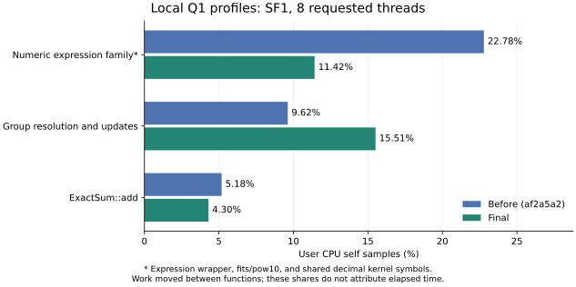

# Hash aggregate — performance step 1 (2026-11-07)

**Local, indicative, NOT a target verdict; local elapsed times cannot attribute gains.** Card 0005's frozen targets are
unchanged. This step changes hashing, cancellation polling, borrowed group-key
lookup and reservation amortization only. R12/P11, P4, P5 and spill volume remain
step 2 work. No GCP, push or merge.

## Method and limits

Local x86-64 Core i3-1220P KVM guest, eight visible logical CPUs.
[Machine/toolchain and input identity](raw/20261107-hash-aggregate-perf1/machine.json).

SF1 (6,001,215 lineitem rows), warm local Parquet; the complete card Q1 body and
high-cardinality HAVING query, 1/8 requested threads. Existing memory admission
can reduce task concurrency at small budgets. Memory controls explicitly use 8 GiB
for both engines; spill controls use 64 MiB for both, with an explicit 4 GiB
Nata disk quota so the already-documented small default disk cap cannot obscure
CPU work. The quota is a measurement override, not a changed default. The historical baseline/hash
stages validate values before timing (exact numeric multisets; only Q1's three
AVG columns use absolute 1e-8 tolerance). Each cell has five alternating
Nata/DuckDB process pairs, switching which engine goes first between rounds.
Startup, planning, decode and CSV rendering are included; timed CSV goes to
`/dev/null`. DuckDB OOM/failure gives no denominator. Spill correctness uses
DuckDB's memory control as oracle, not an incomplete 64 MiB answer.

Raw JSON retains all samples, exits, per-sample 1/5/15-minute machine loads,
and pre-timing gate counters (real spill, peak reservations, requests/releases).
Native tests separately assert that cleanup returns held bytes/live grants to zero.
This is a shared development machine; other sessions compile concurrently.
Neither isolation nor paired old/new Nata binaries in each round is claimed:
adjacent stages are the before/after controls, DuckDB runs in every stage.
The parent rejected local before/after elapsed-time attribution because shared
load and DuckDB drift dominate 10–30% changes. The historical tables below are
descriptive sanity evidence only. Subsequent fixes use local CPU-clock symbol
profiles and one sanity timing; an attributed timing table awaits the parent’s
settled c3d-highcpu-8 heavy job. ARM64 is unmeasured here.

Historical baseline/hash timing reproduction only (superseded; do not spend
more local rounds on it):

```sh
mkdir -p "$HOME/tmp-perf1/spill"
export TMPDIR="$HOME/tmp-perf1"
cargo build --release -p nata -p nata-check
python3 scripts/bench-aggregate-perf1.py STAGE --candidate target/release/nata --data DATA_SF1 --out "$TMPDIR"
```

## Fix 1 — canonical column hashing

Use the already-locked **twox-hash 2.1.5**, newly direct with defaults disabled
and only `xxhash3_64` enabled (no dependency additions). Parent decision:
prefer seeded XXH3-64; aHash 0.8.12 was rejected because AES target features
change its output, while foldhash is absent from the lockfile. This choice is
recorded here for the parent's ADR 0010 amendment; no accepted ADR is edited.

Version-1 hashing uses explicit type domains, little-endian scalar bytes,
UTF-8 values rather than dictionary codes, NULL distinct from empty text,
canonical NaN/zero, ordered column combination and fixed seed
`0x6e61746100000001`. Recursion uses that seed XOR depth; equal keys stay
together and each depth gets a fresh partition distribution. The table and
spill use the same canonical function. Column hashes are computed once per
selected batch and reused for probes. The extra hash vector is explicitly
included in the decode reservation. Full key equality still resolves collisions.

Fixed vectors at depths 0/1/8 were independently calculated using system
libxxhash 0.8.3 and checked against the locked Rust implementation. Unit tests
also compare batch hashes against owned keys for every supported key family,
selected rows, NULL junk, dictionary changes and canonical floats. These tests
will run unchanged on ARM64; this local run is x86-64 only.

[Unsafe inventory](raw/20261107-hash-aggregate-perf1/unsafe-exec.txt): twox-hash
has 75 textual unsafe keywords across 13 source files, including disabled
features/tests; this count is an upper bound, not a soundness proof. It was
already transitive. XXH3 includes portable scalar and SSE2/AVX2/NEON paths.
No own unsafe code is added.

**Harness correction, 2026-11-07:** the first hash-stage spill gate exposed an
invalid new assertion equating reservation requests with releases. Requests
include pending retries; only grants release. No spill timing had started.
The harness now checks peak ≤ B and releases ≤ requests; native cleanup tests
inspect held bytes/live grants directly. The four completed memory cells and
all their samples were retained unchanged, then the two untouched spill cells
were resumed. This is not a failed engine result or an extra timing round.

Seconds **min/median/max**, five rounds per cell. Load is the 1-minute load
range across Nata and DuckDB samples; raw JSON also retains 5/15-minute loads.

| Query | Threads | Nata before | Nata after | DuckDB before | DuckDB after | Load before → after |
|---|---:|---|---|---|---|---|
| q1 memory | 1 | 4.929/5.158/8.526 | 5.185/5.851/8.718 | 0.251/0.271/0.327 | 0.313/0.415/0.686 | 5.4–6.5 → 5.7–7.2 |
| q1 memory | 8 | 3.440/4.670/4.876 | 3.330/3.496/3.933 | 0.150/0.162/0.205 | 0.163/0.210/0.226 | 5.5–6.4 → 5.6–5.8 |
| having memory | 1 | 7.108/18.299/24.173 | 5.419/6.749/7.053 | 1.871/3.492/6.656 | 1.445/1.632/1.874 | 4.6–16.5 → 3.5–4.5 |
| having memory | 8 | 6.719/8.114/12.708 | 5.512/6.091/6.669 | 1.566/3.759/4.737 | 1.353/1.563/2.488 | 8.8–11.1 → 2.9–4.6 |
| having 64 MiB | 1 | 23.329/23.926/36.366 | 13.915/15.203/18.523 | 1.899/1.951/4.521 | 1.479/1.512/1.641 | 3.0–5.8 → 1.3–1.7 |
| having 64 MiB | 8 | 21.896/27.284/28.208 | 18.055/18.314/22.899 | 1.617/1.809/2.089 | 1.516/1.685/2.514 | 2.7–5.0 → 1.9–3.4 |

Raw: [baseline](raw/20261107-hash-aggregate-perf1/baseline.json), [hash](raw/20261107-hash-aggregate-perf1/hash.json).

Historical Q1 medians at eight threads were 4.670 and 3.496 s. The one-thread
Q1 cell is unresolved (both Nata and DuckDB slowed); baseline HAVING has very
large load/noise drift. These historical samples cannot attribute gains, even though only one source
fix changed between stages. No both-CPU or frozen-target
performance claim follows.

### Local profile comparison (CPU-clock user self samples)

Eight requested threads, same SF1 input; CPU shares, **not elapsed gains**.

| Q1 hash-related user self symbols | Before | After |
|---|---:|---:|
| SipHash write + owned-key hashing + Atom::hash_slice | 17.18% | no samples |
| Column hashes + value helper | absent | 2.41% |

Baseline Q1 has SipHash write **10.86%**, owned-key hashing **3.20%**, and
`Atom::hash_slice` **3.12%**. Hash-only Q1 has no sampled SipHash/Atom hash-slice
symbol; column hashing is **1.55%** plus **0.86%** in its value helper. Cancellation (**14.91%**) and contended
mutex locking (**11.72%**) now lead the profile, followed by scalar arithmetic.
All symbols (including the long tail) and the HAVING memory/spill controls are
retained in [baseline Q1](raw/20261107-hash-aggregate-perf1/baseline-q1.json),
[hash Q1](raw/20261107-hash-aggregate-perf1/hash-q1.json), and the adjacent
`baseline-*` / `hash-*` raw profiles. Profile metadata records load, binary
identity, and aggregate counters; elapsed time under profiling is not a timing
sample. Sampling uses `perf record -e cpu-clock:u -F 199 -g --call-graph dwarf,8192`;
GNU `c++filt -s rust` demangles Rust v0 symbols before sorting by self share.

The new recursion-seed mutant is **CAUGHT**, with the unmutated private-copy
control passing: fixed vectors fail and the recursive-pressure replay test also
fails. [Mutant](raw/20261107-hash-aggregate-perf1/mutants-hash.md).
[Required checks](raw/20261107-hash-aggregate-perf1/checks-hash.txt) all pass.

## Fix 2 — bounded cancellation polling

Partial accumulation polls at each batch/resume entry and at most 1,024 selected
rows apart in a larger batch. Ordinary production batches are capped at 256.
Resident merge/finalization and spill writes use the same bounded interval;
repartition polls once per already bounded IPC frame. ScanCancel's mutex,
registration/cancel handshake and memory-manager wakes are unchanged. Tests
count polls, trigger cancellation after an arbitrary resume cursor and during a
large batch, and require cleanup; they do not depend on wall-clock scheduling.

**Validation repair:** the first workspace run failed the existing wire
aggregate-backpressure test's assumption that socket buffers finish filling in
200 ms: produced-row snapshots were 1,958/2,825; an isolated run also failed at
2,771/2,797. The test now waits for an observed stall within its existing
10-second helper deadline, then keeps the unchanged-count, incomplete-output,
cancel/disconnect and released-grant assertions. No wire production code or
resource bound changes. The focused repaired test passes. The existing
unbounded-bridge and bridge-byte-bound mutants are rechecked below.

The parent superseded local elapsed-time attribution before this fix: only one
Q1 sanity timing and CPU-clock profiles are taken. Attributed timing is pending
the parent's settled-machine heavy job; no additional local timing rounds run.

| Q1 user self symbol | Before (hash only) | After (bounded polls) |
|---|---:|---:|
| ScanCancel::is_cancelled | 14.91% | 0.24% |
| Mutex::lock_contended | 11.72% | 0.48% |

Scalar `eval::arith` now leads at 12.25%; `Atom::get`, allocator/free work and
owned-key collection remain visible for fix 3. The one sanity run is 3.245 s at
1-minute load 5.40, **not an attributed elapsed gain**.
[Profiles](raw/20261107-hash-aggregate-perf1/cancel-profiles.json),
[all Q1 symbols](raw/20261107-hash-aggregate-perf1/cancel-q1.json),
[sanity](raw/20261107-hash-aggregate-perf1/cancel-sanity.json).
The new poll-removed and per-row-poll mutants are **2/2 CAUGHT**, zero invalid;
[results](raw/20261107-hash-aggregate-perf1/mutants-cancel.md).
Both existing wire-bound mutants are **CAUGHT**, with their private control
passing and the intended aggregate-bound assertion failing under the mutants:
[results](raw/20261107-hash-aggregate-perf1/mutants-cancel-wire.txt).
The complete [required check sequence](raw/20261107-hash-aggregate-perf1/checks-cancel.txt)
was rerun after the test repair and passes.

Current local profiling reproduction (no timing rounds):

```sh
python3 scripts/profile-aggregate-perf1.py STAGE --sanity --candidate target/release/nata --data DATA_SF1 --out "$HOME/tmp-perf1/profiles"
```

## Fix 3 — borrowed column lookup and a single probe

Existing groups are found with the batch's cached hash and value comparison
against borrowed columns. The returned group ID drives state updates directly,
replacing three probes and an owned `Vec<Atom>`/string key per row. Only a new
group allocates its owned key and states, after its entry/string capacity and
any table growth have been reserved. The per-entry reservation formula is
unchanged; merge/replay still own keys and use the same canonical hash.

A forced-collision test checks dictionary strings, NULL with an invalid junk
dictionary index, empty text, canonical zero/NaN, missing keys and key-arity
mismatches. Scalar arithmetic, aggregate state updates and argument evaluation
are unchanged. This removes group-key allocations for existing groups; it does
not implement step 2's shared/vectorized arithmetic kernels.

| Q1 user self symbol | Before (bounded polls) | After (borrowed lookup) |
|---|---:|---:|
| Owned-key Vec collection in Partial::resume | 2.26% | no samples |
| Atom slice equality | 3.38% | no samples |
| malloc | 4.27% | 2.67% |
| cfree | 4.59% | 1.73% |
| Atom::get (also used for aggregate arguments) | 6.53% | 4.08% |

Scalar `eval::arith` / `num::fits` lead at 15.38% / 8.48%; allocations for
batch evaluation and new groups remain. The one sanity run is 1.084 s at load
2.33, **not an attributed gain**. Q1 still makes 23,499 reservation requests;
fix 4 addresses those independently.
[Profiles](raw/20261107-hash-aggregate-perf1/borrow-profiles.json),
[all Q1 symbols](raw/20261107-hash-aggregate-perf1/borrow-q1.json),
[sanity](raw/20261107-hash-aggregate-perf1/borrow-sanity.json).
The borrowed-equality mutant is **CAUGHT**, with a passing private control and
zero invalid: [result](raw/20261107-hash-aggregate-perf1/mutants-borrow.md).
All [required checks](raw/20261107-hash-aggregate-perf1/checks-borrow.txt) pass.

## Fix 4 — task-owned scratch reservation chunks

The 23,499 Q1 requests were predominantly the string-expression scratch grant
created and released for every 256-row batch, rather than table growth. Each
scan task now retains a charged high-water capacity in the existing `Chunks`
service. Chunks are sized from the batch requirement (at least 64 KiB, clipped
to available capacity by the manager); only growth consumes new credit.
Existing table chunks stay charged and zero-byte table reservations return
immediately. No budget, progress reserve, ledger, gauge, debug assertion or
memory-manager synchronization changes.

`ScanState` drops evaluated/input allocations before scratch chunks and the
decode grant; chunks release on every task exit. The native test repeats 100
batches with one request, grows within spare credit, grows to another chunk,
and requires held bytes/live grants/pending requests to return to zero.

A second test exposed an initial-draft error: another task's differently sized
pending request was propagated as a minimum-set error. The negative control
fails at that exact path; the final cache treats denial/conflict as pressure,
preserving the previous caller's spill/retry and minimum-set error behavior.
After release/pressure cleanup, the test retries successfully and checks the
budget/cleanup invariants. [Negative control](raw/20261107-hash-aggregate-perf1/scratch-pressure-negative.txt),
[fixed control](raw/20261107-hash-aggregate-perf1/scratch-pressure-positive.txt).
All [required checks](raw/20261107-hash-aggregate-perf1/checks-chunks.txt)
pass on that final implementation. The new chunk-release mutant is CAUGHT
by both scratch tests, with passing unmutated controls; it is among the
[first 15 completed catches](raw/20261107-hash-aggregate-perf1/mutants-first-segment.txt).
The final profile is recorded below after the sequential sweep.

| Q1 counter / self symbol | Before (borrowed lookup) | After (task chunks) |
|---|---:|---:|
| Reservation requests | 23,499 | 67 |
| Reservation releases | 23,499 | 67 |
| MemoryManager::request self samples | 0.31% | no samples |
| Mutex::lock_contended | 1.26% | 0.93% |
| Peak reservation (bytes; B = 8 GiB) | 152,135,208 | 152,530,216 |

The request count is down by a deterministic workload count, not a local
elapsed-time claim. Numeric-key HAVING's memory control stays at 2,592 requests:
it did not have per-batch string scratch. The one Q1 sanity run is **1.344 s**
at load **1.64**, not an attributed gain. The small mutex share change is
sampling/noise-limited. [Profiles and counters](raw/20261107-hash-aggregate-perf1/chunks-profiles.json),
[Q1 sanity](raw/20261107-hash-aggregate-perf1/chunks-sanity.json).

### Cumulative mutation verification

The initial full-set sweep completed 15 real catches, including all five new
mutants and every existing aggregate/spill mutant, then the old
`case-evaluates-every-branch` mutant ran the newer deep aggregate CASE fixture
exponentially before reaching its original guard check. That incomplete run
was terminated and **is not counted as a catch or a timeout catch**. The CASE
mutant now runs its existing `case_evaluates_only_the_branch_a_row_takes` test;
full unmutated exec/CLI controls still run, and other mutants retain their full
suites. The remaining 48 mutants passed with that bounded test selection.
**All 63 executor/CLI mutants are CAUGHT (58 existing, five new), zero
SURVIVED, zero INVALID**, with passing private unmutated exec/CLI controls.
[Combined results](raw/20261107-hash-aggregate-perf1/mutants-all.md),
[remaining 48](raw/20261107-hash-aggregate-perf1/mutants-remaining.md).
The [outcome-classifier self-test](raw/20261107-hash-aggregate-perf1/mutant-classifier.txt)
passes; compile failures/global timeouts remain INVALID.
All [five memory mutants](raw/20261107-hash-aggregate-perf1/mutants-memory.txt)
are **CAUGHT by loom** at bound 2 (including explicit budget/credit/double-release
assertions and lost-wakeup/release deadlocks); unmutated native memory checks
and all 16 bound-2 memory models pass. The two existing wire-bound mutants
remain CAUGHT as recorded under fix 2.

## Final profile and step 2

**Local, indicative, NOT a target verdict.** CPU-clock user self shares, eight
requested threads, SF1. Q1 / HAVING memory / HAVING 64 MiB have
756 / 1,126 / 2,450 samples and zero reported lost samples. Starting
1-minute loads are 1.64 / 1.64 / 1.67. No elapsed attribution follows.
Full demangled names and the long tail are retained in the linked raw JSON.
[Per-fix evidence chart](raw/20261107-hash-aggregate-perf1/profile-summary.html).

### Q1 memory

[All symbols](raw/20261107-hash-aggregate-perf1/chunks-q1.json).

| Rank | Self | Symbol |
|---:|---:|---|
| 1 | 11.77% | `nata_exec::eval::arith` |
| 2 | 11.24% | `<nata_exec::aggregate::Partial>::resume` |
| 3 | 10.71% | `nata_exec::num::fits` |
| 4 | 5.82% | `<nata_exec::aggregate::State>::add` |
| 5 | 4.37% | `<nata_kernels::aggregate::ExactSum>::add` |
| 6 | 4.37% | `<nata_exec::aggregate::Atom>::get` |
| 7 | 3.44% | `<nata_exec::value::Col>::from_arrow` |
| 8 | 2.25% | `nata_exec::aggregate::hashing::columns` |
| 9 | 2.25% | `_int_malloc` |
| 10 | 1.98% | `nata_exec::aggregate::hashing::value` |
| 11 | 1.98% | `cfree@GLIBC_2.2.5` |
| 12 | 1.85% | `<nata_exec::eval::Evaluator>::eval` |
| 13 | 1.85% | `malloc` |
| 14 | 1.72% | `nata_exec::num::pow10` |
| 15 | 1.59% | `_int_free_chunk` |

### HAVING memory

[All symbols](raw/20261107-hash-aggregate-perf1/chunks-high_cardinality_tpch.json).

| Rank | Self | Symbol |
|---:|---:|---|
| 1 | 12.08% | `nata_exec::aggregate::hashing::key` |
| 2 | 6.93% | `<nata_exec::aggregate::Partial>::resume` |
| 3 | 4.53% | `<nata_exec::aggregate::State>::finalize` |
| 4 | 3.55% | `malloc` |
| 5 | 3.55% | `unlink_chunk.isra.0` |
| 6 | 3.46% | `hashbrown::RawTable<usize>::reserve_rehash` |
| 7 | 3.02% | `nata_exec::eval::arith` |
| 8 | 2.75% | `_int_free_chunk` |
| 9 | 2.31% | `__memmove_avx_unaligned_erms` |
| 10 | 2.22% | `_int_malloc` |
| 11 | 2.13% | `nata_exec::num::fits` |
| 12 | 1.87% | `<nata_exec::aggregate::State>::add` |
| 13 | 1.78% | `<arrow_buffer::buffer::scalar::ScalarBuffer<f64>>::slice` |
| 14 | 1.69% | `<nata_exec::aggregate::Groups>::insert` |
| 15 | 1.69% | `<alloc::sync::Arc<dyn arrow_array::array::Array>>::drop_slow` |

### HAVING 64 MiB

[All symbols](raw/20261107-hash-aggregate-perf1/chunks-high_cardinality_tpch-64MiB.json).

| Rank | Self | Symbol |
|---:|---:|---|
| 1 | 6.49% | `_int_malloc` |
| 2 | 4.90% | `malloc` |
| 3 | 4.29% | `malloc_consolidate` |
| 4 | 3.92% | `_int_free_chunk` |
| 5 | 3.31% | `__memmove_avx_unaligned_erms` |
| 6 | 3.31% | `cfree@GLIBC_2.2.5` |
| 7 | 2.08% | `replay::decode state collection (Iterator::try_fold)` |
| 8 | 2.08% | `nata_exec::aggregate::replay::encode` |
| 9 | 1.76% | `nata_exec::eval::arith` |
| 10 | 1.71% | `realloc` |
| 11 | 1.67% | `unlink_chunk.isra.0` |
| 12 | 1.63% | `flatbuffers::TableVerifier::visit_field (IPC schema fields)` |
| 13 | 1.59% | `<nata_exec::aggregate::Partial>::resume` |
| 14 | 1.55% | `flatbuffers::verifier::append_trace::<()>` |
| 15 | 1.55% | `<flatbuffers::verifier::TableVerifier>::deref` |

Step 2 must address the following measured remaining work; none is implemented here:

- **R12/P11 kernels:** scalar `eval::arith` (11.77%) and decimal `num::fits`
  (10.71%) lead Q1. Move evaluation onto shared selected-valid strict kernels
  and vectorized loops while preserving errors, NULL masking and exact types.
- **P4 fusion:** Q1 still spends 11.24% in `Partial::resume`, 5.82% in
  `State::add`, 4.37% each in `ExactSum::add` and `Atom::get`. Fuse evaluation
  and accumulation, including repeated Q1 expressions, against a measured control.
- **P5 overflow elision:** only remove repeated checks where a proof establishes
  the same accepted bounds and failure behavior. No elision occurs in this step.
- **Spill volume:** allocation/free, replay encode/decode and checked IPC
  metadata dominate the spill profile. HAVING at 64 MiB writes 960,268,264
  bytes, reads 1,219,572,960 bytes and opens 300,682 spill files (4,368 spilled
  partitions, recursion depth 2). Reduce partial/frame/open volume; preserve
  envelope verification, reservations and quotas. Resident HAVING also exposes
  canonical owned-key hashing (12.08%), state finalization (4.53%) and rehash
  (3.46%): track those costs when assessing fusion/volume changes.

Frozen targets, SF10 scaling and both-architecture certification remain open.
Local elapsed times and these self-share profiles cannot close them.

## Parent timing job — attribution pending

The four cumulative fixes are `94a7834` (hash), `3748b56` (polls), `8b8873b`
(borrowed lookup), and `135fd7d` (chunks). The parent will add the attributed
before/after table after the settled-machine run; no local timing ratio is
used to claim a gain.

[Harness](../../scripts/bench-aggregate-perf1-heavy.py) and
[heavy recipe](../aggregate-perf1.steps). Prepare the source bundle locally
before shipping the tree, since the existing uploader excludes `.git`:

```sh
python3 scripts/bench-aggregate-perf1-heavy.py prepare --baseline e198d08 --fix hash=94a7834 --fix polls=3748b56 --fix borrow=8b8873b --fix chunks=135fd7d --bundle .aggregate-perf1-inputs
cp bench/aggregate-perf1.steps heavy.steps
```

Only the parent launches the existing `heavy` job, on **c3d-highcpu-8**.
The bundle and `heavy.steps` are ignored locally; the existing tree uploader
includes them. Five SHA-256-checked committed source archives build sequentially
with `--locked --release`, each in a distinct target directory. The run refuses
a CPU count/architecture other than x86-64/eight logical CPUs. It records input
and binary identities, toolchain, CPU model, all 1/5/15-minute loads, exits and
aggregate counters, without host/network identifiers.

The matrix is Q1 and HAVING × 1/8 threads × 8 GiB/64 MiB, five alternating
rounds of baseline, each cumulative fix and DuckDB, with an identical-binary
primary/twin arm for each: **480 timed processes**. Reverse the entire arm
order on alternate rounds. Match engine budgets/threads; include startup,
planning, metadata, decode and CSV-to-`/dev/null`. Correctness-gate all 40 Nata
cells against DuckDB before **any** timing; require peak ≤ B, no memory-control
spill and real HAVING spill at 64 MiB. Q1 AVG alone has the card's 1e-8 tolerance;
all other numbers/multiplicities match exactly. Settle below load 0.5 before
each cell and refuse an unsettled cell. No correctness/build job overlaps a
timed cell. Each restarted heavy timing step creates a new session directory;
incomplete sessions never mix.

`summary.json` reports min/quartiles/median/max for five primary and five twin
samples per variant/cell, paired candidate/baseline, candidate/previous-fix
and candidate/DuckDB latency ratios, and twin/primary ratios. A failed DuckDB
cell has no denominator. The parent compares each change with its twins/noise
and adds the attributed table here; the harness makes no target verdict.
SF10 scaling and ARM64 remain outside this SF1 job.

[Local harness checks](raw/20261107-hash-aggregate-perf1/heavy-self-test.txt)
launch no engines: self-test covers exact numeric
multisets/multiplicity, Q1 AVG tolerance versus exact SUM, truncated CSV,
archive tampering, alternating twins, distinct targets, matched budgets,
paired ratios and missing DuckDB denominators. An inert end-to-end run also checks five builds, all 40 gates before any
timed arm, and the complete 480-arm schedule. Preparing all five actual
archives and checking both queries in each archive, then `run --plan`, passed; the [saved plan](raw/20261107-hash-aggregate-perf1/heavy-plan.json)
contains five separate targets and all 480 planned processes.

```sh
python3 scripts/bench-aggregate-perf1-heavy.py self-test --work "$HOME/tmp-perf1/self-test"
python3 scripts/bench-aggregate-perf1-heavy.py run --bundle .aggregate-perf1-inputs --work "$HOME/tmp-perf1/heavy" --data DATA_SF1 --out "$HOME/tmp-perf1/heavy-results" --plan
```

## Validation and handoff

Before each production fix commit: `cargo fmt --check`, workspace/all-target
clippy with `-D warnings`, `cargo test --workspace`, `cargo deny check`, query
gates (scan 5, SQL 252, SQL differences 54, aggregate 65, forced-spill aggregate
65), all 16 memory loom models at bound 2, and staged leak scan **pass**.
Disk TMPDIR/spill storage and two build/test workers are used; checks run
sequentially. The final tooling commit repeats that entire sequence:
[check record](raw/20261107-hash-aggregate-perf1/checks-harness.txt).

Cumulative relevant mutation checks: **63 executor/CLI + five memory + two
wire-bound = 70 CAUGHT**, zero survivors/invalids. The five new mutants cover
recursion seed, removed/row-wise cancel polls, borrowed equality and chunk
release. The independent negative/positive pressure regression is retained.
The one interrupted exponential CASE attempt is excluded, as explained above.

The existing heavy-job chain test also passes using its local inert runner,
without a VM or cloud calls. The source bundle/plan and full simulated harness
trial pass. The parent runs the real settled-machine job and adds attribution;
no frozen target is judged here, and step 2 implementation is not started.

## Step 1 attributed timing on a settled machine (run `perf1-x86-r2`, added by the parent, 2026-11-07)

One settled Spot c3d-highcpu-8 (x86-64), five revisions built from committed archives (baseline `490d116`, then the four fixes
cumulatively), 5 alternating rounds with a twin per arm, DuckDB 2.0.0 alongside, SF1. VM compute $0.078. Raw: `raw/20261107-hash-aggregate-perf1-gcp/`.
A first attempt (`perf1-x86`) failed in two minutes on Python 3.11.2's missing `extractall(filter=)`; fixed in `eb17021`.

Medians in seconds (min/quartiles/max and twins are in `summary.json`):

| Query, threads, budget | baseline | +XXH3 hash | +batch cancel | +borrowed keys | +chunked reservations | DuckDB | final / DuckDB |
|---|---:|---:|---:|---:|---:|---:|---:|
| Q1, 1, in memory | 4.071 | 3.236 | 3.230 | 2.822 | 2.854 | 0.254 | 11.2x |
| Q1, 1, 64 MiB | 4.298 | 3.433 | 3.345 | 2.907 | 2.846 | 0.263 | 10.8x |
| Q1, 8, in memory | 1.625 | 1.431 | 1.394 | 1.184 | 1.190 | 0.116 | 10.3x |
| Q1, 8, 64 MiB | 1.927 | 1.862 | 1.610 | 1.498 | 1.440 | 0.116 | 12.4x |
| high cardinality, 1, in memory | 5.923 | 5.020 | 4.830 | 4.756 | 4.659 | 1.171 | 4.0x |
| high cardinality, 1, 64 MiB | 15.398 | 14.378 | 14.178 | 13.582 | 13.501 | 1.318 | 10.2x |
| high cardinality, 8, in memory | 3.859 | 3.586 | 3.376 | 3.327 | 3.353 | 0.931 | 3.6x |
| high cardinality, 8, 64 MiB | 18.296 | 17.564 | 17.378 | 17.328 | 17.633 | 1.251 | 14.1x |

**Verdict against the frozen targets: NOT MET in every cell** (Q1 ≤1.5x, hash queries ≤2x, spill ≤2x). Step 1 removed its overheads
(about 25-30% on Q1, 13-21% on the high-cardinality query) but leaves the row-at-a-time computation (step 2a) and the spill volume
(step 2d, almost untouched by step 1: -4% at 8 threads) as the gap.

## Performance step 2a — shared column kernels and group vectors

**Verdicts:** all required local checks pass; **7/7 focused runtime mutants are
CAUGHT**, zero survivors/invalids; **4/4 Kani harnesses pass, 8/8 covers**, and a
private Kani precision-check mutant is CAUGHT after its control passes. Full
existing mutant sweeps remain for the parent heavy job. **No performance target
is assessed or claimed met.** The final local sanity is slower, as recorded
below; there are no local twins or settled-machine denominators.

The frozen rule remains: full Q1 ≤1.5× DuckDB, agg_orderkey/agg_partkey ≤2×,
spill ≤2× in matched-budget cells where DuckDB completes, SF10 8/1 scaling ≥5×
ARM64 / ≥3.5× x86-64. No GCP run was made. Parent measurement is required.
[Machine, toolchain and SF1 input identity](raw/20261107-hash-aggregate-perf2a/machine.json);
[production source hashes](raw/20261107-hash-aggregate-perf2a/source-sha256.txt).

### Fresh local profiles and sanity times

SF1, eight requested threads, CPU-clock user self sampling at 199 Hz with DWARF
call graphs. Shares are relative, functions changed, and work moved into the
kernel; neither a disappearing symbol nor a lower share proves a lower latency.
The historical step 1 profile is not reused as this comparison's denominator.

| Self symbol | af2a5a2 before | Final |
|---|---:|---:|
| `nata_exec::eval::arith` | 12.87% | 0.21% |
| `nata_exec::num::fits` | 7.54% | 0.00% |
| `aggregate::Partial>::resume` | 9.62% | 15.51% |
| `decimal::Decimal>::column` | 0.00% | 11.11% |
| `aggregate::ExactSum>::add` | 5.18% | 4.30% |



| Stage | One Q1 CLI sanity, s | Starting load (1 minute) |
|---|---:|---:|
| af2a5a2 | 1.136 | 3.23 |
| Column kernels and group vectors | 1.064 | 1.53 |
| Final: checked i64 multiply and in-place narrow SUM | 2.199 | 3.31 |

**Indicative only:** one completion sanity per change, without alternating
controls. Concurrent development work was present. The slower final observation
is retained; it is not filtered out or attributed to a particular change.
No further local timing rounds were run. The intermediate profile exposed SUM
state reconstruction; assembly inspection motivated updating the narrow sum in
place, with the same checks. There is no isolated timing claim for that fix.

| Profile | Before samples / lost | Final samples / lost | Before / final load (1 min) |
|---|---:|---:|---:|
| Q1 memory | 676 / 0 | 954 / 0 | 3.23 / 3.31 |
| HAVING memory | 1007 / 0 | 1522 / 0 | 3.61 / 3.13 |
| HAVING 64 MiB | 2418 / 0 | 3663 / 0 | 3.32 / 3.12 |

#### Final top 15: Q1 memory

[All symbols and counters](raw/20261107-hash-aggregate-perf2a/inplace-q1.json); [text](raw/20261107-hash-aggregate-perf2a/inplace-q1.txt). Long names below are shortened after 180 characters.

| Rank | Self | Symbol |
|---:|---:|---|
| 1 | 15.51% | `<nata_exec::aggregate::Partial>::resume` |
| 2 | 11.11% | `<nata_kernels::decimal::Decimal>::column` |
| 3 | 4.30% | `<nata_kernels::aggregate::ExactSum>::add` |
| 4 | 3.98% | `<nata_exec::value::Col>::from_arrow` |
| 5 | 3.88% | `_int_malloc` |
| 6 | 3.67% | `__memmove_avx_unaligned_erms` |
| 7 | 3.56% | `malloc` |
| 8 | 3.04% | `nata_exec::aggregate::hashing::columns` |
| 9 | 2.31% | `std::sys::backtrace::__rust_begin_short_backtrace::<nata_sched::cooperative::run<nata_exec::aggregate::pipeline::ScanState, alloc::vec::Vec<nata_exec::aggregate::Table>, nata_pa...` |
| 10 | 2.10% | `__memset_avx2_unaligned_erms` |
| 11 | 2.10% | `cfree@GLIBC_2.2.5` |
| 12 | 1.99% | `_int_free_chunk` |
| 13 | 1.68% | `nata_exec::aggregate::hashing::value` |
| 14 | 1.57% | `<std::sys::sync::mutex::futex::Mutex>::lock_contended` |
| 15 | 1.57% | `<arrow_array::array::primitive_array::PrimitiveArray<arrow_array::types::IntervalMonthDayNanoType> as arrow_array::array::Array>::is_valid` |

#### Final top 15: HAVING memory

[All symbols and counters](raw/20261107-hash-aggregate-perf2a/inplace-high_cardinality_tpch.json); [text](raw/20261107-hash-aggregate-perf2a/inplace-high_cardinality_tpch.txt). Long names below are shortened after 180 characters.

| Rank | Self | Symbol |
|---:|---:|---|
| 1 | 11.83% | `nata_exec::aggregate::hashing::key` |
| 2 | 10.38% | `<nata_exec::aggregate::Partial>::resume` |
| 3 | 5.19% | `malloc` |
| 4 | 4.34% | `<nata_exec::aggregate::State>::finalize` |
| 5 | 3.88% | `unlink_chunk.isra.0` |
| 6 | 3.42% | `_int_malloc` |
| 7 | 2.69% | `cfree@GLIBC_2.2.5` |
| 8 | 2.56% | `_int_free_chunk` |
| 9 | 2.50% | `<nata_kernels::decimal::Decimal>::column` |
| 10 | 2.37% | `<hashbrown::raw::RawTable<usize>>::reserve_rehash::<<nata_exec::aggregate::Groups>::try_reserve::{closure#0}>` |
| 11 | 2.30% | `__memmove_avx_unaligned_erms` |
| 12 | 1.64% | `<nata_exec::aggregate::Groups>::insert` |
| 13 | 1.38% | `<snap::decompress::Decoder>::decompress` |
| 14 | 1.38% | `syscall` |
| 15 | 1.18% | `<nata_kernels::aggregate::ExactSum>::decimal_sum` |

#### Final top 15: HAVING 64 MiB

[All symbols and counters](raw/20261107-hash-aggregate-perf2a/inplace-high_cardinality_tpch-64MiB.json); [text](raw/20261107-hash-aggregate-perf2a/inplace-high_cardinality_tpch-64MiB.txt). Long names below are shortened after 180 characters.

| Rank | Self | Symbol |
|---:|---:|---|
| 1 | 5.95% | `_int_malloc` |
| 2 | 5.02% | `malloc` |
| 3 | 3.99% | `malloc_consolidate` |
| 4 | 3.63% | `_int_free_chunk` |
| 5 | 3.19% | `cfree@GLIBC_2.2.5` |
| 6 | 2.87% | `__memmove_avx_unaligned_erms` |
| 7 | 2.07% | `<nata_exec::aggregate::Partial>::resume` |
| 8 | 1.91% | `<core::iter::adapters::map::Map<core::slice::iter::Iter<nata_sql::bind::AggregateExpr>, nata_exec::aggregate::replay::decode::{closure#2}> as core::iter::traits::iterator::Itera...` |
| 9 | 1.77% | `flatbuffers::verifier::append_trace::<()>` |
| 10 | 1.77% | `realloc` |
| 11 | 1.77% | `unlink_chunk.isra.0` |
| 12 | 1.58% | `__syscall_cancel_arch` |
| 13 | 1.56% | `nata_exec::aggregate::replay::encode` |
| 14 | 1.31% | `<flatbuffers::verifier::TableVerifier>::visit_field::<flatbuffers::primitives::ForwardsUOffset<flatbuffers::vector::Vector<flatbuffers::primitives::ForwardsUOffset<arrow_ipc::ge...` |
| 15 | 1.28% | `__memset_avx2_unaligned_erms` |

Reproduce profiles with a separately built baseline/final binary, on the same
SF1 data (this runs each query once under perf and Q1 once as a completion sanity):

```sh
python3 scripts/profile-aggregate-perf1.py STAGE --sanity --candidate BINARY --data DATA_SF1 --out DISK_DIRECTORY
```

Implementation:

- Arithmetic on integer and decimal argument columns now calls `nata-kernels`.
  The decimal kernel prepares scale factors and the result limit once per
  expression, dispatches ADD/SUB/MUL outside the selected-row loop, and retains
  checked machine arithmetic, both ADD/SUB operand-fit checks, and the result
  precision check. Decimal64 results use checked i64 multiplication after
  checked operand conversions, with checked i128 fallback for wide operands.
  A `2^59 * 32` sentinel catches a 64-bit wrap to zero. Errors retain the expression position and error class.
  Numeric cast/negation and comparison traversal use shared selection/validity
  adapters; exact rescaling/rounding helpers have one shared implementation.
  Existing text/date/float conversion and comparator semantics remain in their
  original adapters: this is not a claim that every scalar operation is proved.
- Hashes still use step 1's canonical XXH3 columns and collision-resolving
  `hashbrown` table. A bounded group-index vector resolves probe/insert first;
  aggregate columns then update from those IDs, with separate validity per
  argument. COUNT avoids constructing an Atom; SUM/AVG dispatch the input type
  once per column. MIN/MAX make column-wise passes with their existing typed
  comparator. Owned keys/state arenas and spill records remain compatible.
- SUM/AVG use checked i128 partials, promoting to the existing checked i256
  representation when i128 overflows. Promotion is exact, not an SQL overflow;
  final precision is checked only after merge. All value/count checks remain.
  Spill still writes the same 32 little-endian sum bytes plus non-NULL count;
  the validated IPC reader is unchanged. Existing oracle/boundary tests cover
  wide cancellation, AVG without narrowing SUM, and malformed replay.
- Each admitted prefix is updated before pressure spills its table; the denied
  row is retried with fresh IDs. A 1024-row vector is stack-bounded, and its
  16 KiB is charged in each task's decode/expression grant before work starts.
  Entry and 1024-row cancellation polls, string growth grants, partitioned
  recursive merge and cleanup are retained. No custom dense-key table was added.

### Checks and mutation evidence

With disk-backed `TMPDIR`, fmt, workspace clippy with warnings denied, workspace
tests, cargo deny, release build, scan **5/5**, SQL **252/252**, SQL differences
**55/55**, aggregate **65/65**, forced-spill aggregate **65/65**, and all **16**
memory loom models at bound 2 pass. No dependency or accepted ADR changed.
[Check record](raw/20261107-hash-aggregate-perf2a/checks.txt). Staged leak scanning is recorded there.

An unchanged scanner test initially reported `not_read=1, abandoned=0`: the slow
task had not started when LIMIT completed. Its isolated rerun and the complete
workspace rerun with `RUST_TEST_THREADS=1` pass, including all 15 parallel-scan
tests. No scanner test or implementation was changed. [Failure](raw/20261107-hash-aggregate-perf2a/parallel-first-failure.txt),
[isolated retry](raw/20261107-hash-aggregate-perf2a/parallel-retry.txt).

The executor private control passes, then **5/5** targeted mutations are CAUGHT:
selection ignored, SUM NULL bitmap ignored, group index off by one, decimal
precision check removed, and the existing per-row cancel-poll mutant retargeted
inside group resolution. [Results](raw/20261107-hash-aggregate-perf2a/mutants-exec.md).
Both new kernel mutations are CAUGHT after private controls pass: [decimal
precision](raw/20261107-hash-aggregate-perf2a/mutants-kernels.txt), [checked i64 multiply replaced by wrapping](raw/20261107-hash-aggregate-perf2a/mutants-kernel-machine.txt).
The Kani precision-check negative control is [CAUGHT](raw/20261107-hash-aggregate-perf2a/kani-negative.txt), with
[passing private control](raw/20261107-hash-aggregate-perf2a/kani-negative-control.txt) and [failing proof](raw/20261107-hash-aggregate-perf2a/kani-negative-mutant.txt).
Timeouts/compile failures are not counted as catches in these results.

All **66** executor mutation definitions have unique live anchors, verified by
`test_mutate.py`; moved arithmetic/cast mutations target the called kernel code,
and the kernel crate is copied privately before mutation. This is not a claim
that the full 66-mutant sweep was rerun locally. Existing full sweeps remain
pending for the parent, using a disk-backed working directory and one job at a
time (the long sweeps belong on its approved heavy VM):

```sh
python3 crates/nata-exec/mutate.py --work WORK/exec --out RESULTS/exec.md
python3 crates/nata-kernels/mutate.py --jobs 1
python3 crates/nata-kernels/scripts/mutate_guards.py
```

### Proof coverage and limits

All four new harnesses pass, with **8/8 covers satisfied** (two covers per
harness). [MUL](raw/20261107-hash-aggregate-perf2a/kani-mul.txt), [ADD](raw/20261107-hash-aggregate-perf2a/kani-add.txt), [SUB](raw/20261107-hash-aggregate-perf2a/kani-sub.txt), [i128 boundary](raw/20261107-hash-aggregate-perf2a/kani-machine_overflow.txt). The harnesses include the actual production `decimal.rs` by path, following the
existing Kani crate. The two-row ADD/SUB/MUL proof uses arbitrary signed 8-bit
values, arbitrary validity vectors and all subset selections, a 2-digit result
bound, and independent exact scalar formulas, with an unwind bound of 3. The
machine-boundary harness (unwind 8) exercises both
signed i128 machine-overflow boundaries and NULL masking. Covers require both
error and successful selected/NULL paths.

Trust points: full-domain i128 multiplication, arbitrary precision/scale
combinations, integer type-range/MIN÷−1 logic, division/remainder and exact
cast rescaling are not proved by
these bounded harnesses. They retain checked std primitives and are exercised
by the independent bounded scalar tests, existing expected-value and SQL
boundary tests, and normal/forced-spill differential gates. The new i128-to-i256
promotion and the shared COUNT helper are test-backed trust points: the proof
spike has only a NullBuffer stub, not Arrow's real i256, so it cannot prove that
path. The unchanged Arrow i256/count state bounds remain those of ADR 0010.
No overflow check was removed under a reasoned bound (P5).

Parent proof commands (also suitable for rechecking the local results):

```sh
cd spikes/kani-nata-kernels
cargo kani --harness decimal_column_selected_null_and_bounds
cargo kani --harness decimal_column_add_selected_null_and_bounds
cargo kani --harness decimal_column_sub_selected_null_and_bounds
cargo kani --harness decimal_column_machine_overflow
```

### Settled parent timing job

The existing heavy harness accepts one to four cumulative revisions and an
explicit `--machine` for either requested 8-vCPU architecture. With one fix it
runs **16 Nata correctness cells before 240 timed processes**: Q1 and the
high-cardinality HAVING query, 1/8 threads, 8 GiB/64 MiB, five alternating rounds,
primary and twin for both Nata revisions and DuckDB. All engines include CLI
startup, planning, decode and CSV to `/dev/null`. Budgets are matched; failed
DuckDB cells have no denominator. Source archives, binary/input hashes, loads,
spill counters, paired ratios and twin noise remain recorded. The extended
inert self-test exercises both the old five-revision x86 job and the new
two-revision ARM job, including gates preceding all timings.

Prepare locally after committing, then let the parent copy the bundle with the
source and run the command separately on a settled **c3d-highcpu-8** and
**n4a-highcpu-8** (substitute the matching MACHINE and disk-backed WORK/RESULTS):

```sh
python3 scripts/bench-aggregate-perf1-heavy.py prepare --baseline af2a5a2 --fix vector=HEAD --bundle .aggregate-perf2a-inputs
python3 scripts/bench-aggregate-perf1-heavy.py run --machine MACHINE --bundle .aggregate-perf2a-inputs --work WORK --data DATA_SF1 --out RESULTS
```

[Parent heavy recipe](../aggregate-perf2a.steps). No target verdict follows from
SF1 local profiles; the frozen SF10 scaling cells still need the parent's runs.

### Following steps

- **2b / P4:** independently measure expression-to-aggregate fusion, including
  repeated argument materialization and scans of the group vector. Retain
  selection, NULL and positioned-error phase semantics; keep a generic control.
- **2c / P5:** prove bounds for the actual called kernels and promote/merge
  paths, mutation-check those proofs, then independently measure any check
  elision. Step 2a removes no checks.
- **2d:** measure and reduce spill volume and allocator/IPC work at matched
  budgets, while retaining reader validation, quota/FD bounds and recursive
  cleanup. Step 2a intentionally retains the spill state format.

R12/P11 have this implementation and its evidence. Their register entries stay
open pending the parent's settled both-CPU verdict and the remaining
text/date/float conversion adapters; the bounded proofs above do not certify
those adapters or the full i128 input domain.
